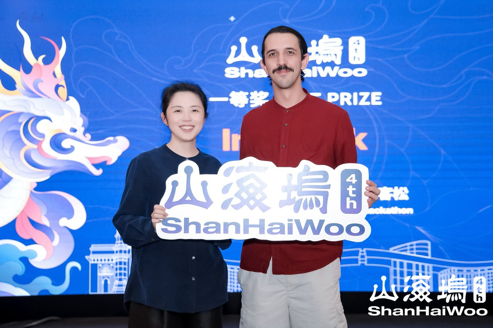

# Florianópolis → Shenzhen · Kit de imprensa

Material para jornalistas, criadores e comunidades sobre a conquista do **1º e 3º lugares no ShanHaiWoo AI × Hardware Hackathon**, em Shenzhen, de 21 a 23 de outubro de 2026.

**Ion “Zeugh” Neto**, brasileiro nascido em Florianópolis, venceu como competidor com o **Interlock**, protótipo de controle de robôs com IA sob supervisão humana. **Murilo Leite**, estudante da UFSC, integrou a equipe do **Marco**, projeto de assistência doméstica a idosos que ficou em terceiro, ao lado de Medhi Loup e sua equipe.

## Acessar o material

- [Release completo em português](release.txt)
- [Kit visual com fotos e fontes](index.html) — baixe e abra no navegador; o GitHub exibe o código HTML.
- [Fotos originais](fotos/)
- [Legendas e créditos](fotos/legendas-e-creditos.txt)
- [Baixar o pacote completo](https://github.com/Zeugh-eth/shanhaiwoo-press-kit/archive/refs/heads/main.zip)
- [Código e documentação do Interlock](https://github.com/Zeugh-eth/interlock-controler)

Fonte: ShanHaiWoo. Autoria fotográfica individual não informada.

## Base de divulgação

[Consultar os 42 veículos contatados e os seis criadores/comunidades](divulgacao/README.md), com contatos públicos, fontes e status registrados. Disponível também em [CSV](divulgacao/veiculos.csv) e [JSON](divulgacao/veiculos.json). Envio não implica cobertura ou endosso.

## Contexto e atribuição

Ion participou da organização da delegação brasileira, dos cursos na UFSC e da competição local em Florianópolis, com apoio da universidade e do professor Jean Martina. **Na competição em Shenzhen, sua atuação foi como competidor.**

A imersão também incluiu visitas a fábricas e uma aula sobre IA com a equipe de engenharia da Tencent, segundo os participantes. Isso não implica patrocínio ou endosso da Tencent aos projetos.

O Interlock está em estágio de protótipo. Mecanismos de autorização, interrupção e retomada humana não representam certificação de segurança industrial. O Marco é uma proposta de assistência; não se alegam testes clínicos ou eficácia comprovada.

## Fontes

- [Formação na UFSC](https://noticias.ufsc.br/event/aula-aberta-eag-global-buildathon-builder-education-session-at-ufsc/?instance_id=6365)
- [Competição em Florianópolis](https://luma.com/5fbmh4p9)
- [Hackathon em Shenzhen](https://luma.com/shanha-ci3e)
- [Programa ShanHaiWoo](https://www.shanhaiwoo.com/)
- [Fotos do encontro](https://x.com/shanhaiwoo/status/2113689545372037310)
- [Fotos das apresentações e premiação](https://x.com/shanhaiwoo/status/2113689589735174146)

O kit visual contém fontes adicionais sobre Shenzhen. Informações biográficas e o relato da experiência foram fornecidos por Ion.

## Uso das imagens

As imagens foram fornecidas por Ion a partir das publicações do ShanHaiWoo e preservadas sem cortes ou alterações. O repositório não concede licença aberta sobre fotos, marcas ou outros materiais de terceiros. Para republicação, confirmar os créditos e as condições de uso com a organização. Ver [créditos](fotos/legendas-e-creditos.txt).

## Entrevistas e informações

**Ion “Zeugh” Neto** · ionneto@gmail.com

Integrante da blockful; head de pesquisa da Fator.ai e do Frontier Hub.

Material atualizado em 28 de outubro de 2026.
